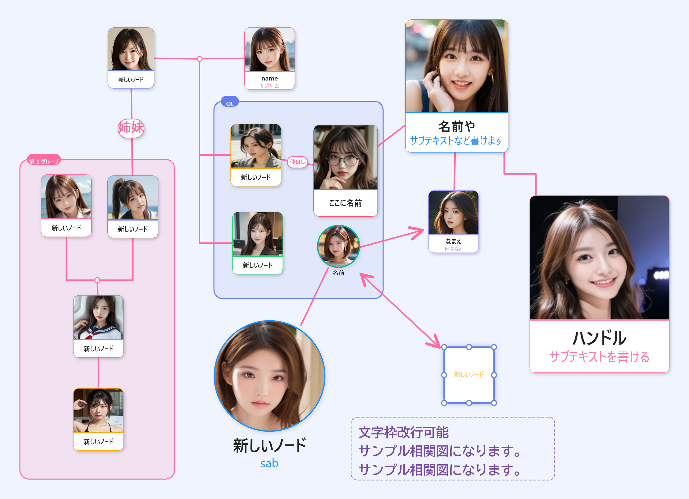

# RelationGraph（相関図メーカー）

ドラマや小説・ゲームの人物相関図を手軽に作れる、Windows用デスクトップアプリです。

## 主な機能

### 人物・ノード
- 人物ノードに写真を設定（トリミング機能付き）
- 全11スタイル：カード型／コンパクト／シンプル枠／丸型／丸写真カード／丸写真＋リボン／写真の形を選ぶ（円・六角形・ひし形・星・ハート・角丸）／写真だけ／配信者カード／名札・トレカ風／吹き出し
- 丸写真の背景を「透過／単色／グラデーション」から選べます
- クリップボードの画像を貼り付け、複数画像をまとめてドロップしてノードを一括作成

### 線・グループ
- 実線・破線・点線・二重線・直角折れ線・矢印など豊富な線種
- ラベル付きの接続線、1対多のフォーク接続
- 線が流れるアニメーション
- グループ枠でキャラクターをまとめて表示

### 編集をラクにする機能
- 複数タブで複数の図を同時に編集
- 自動保存とクラッシュ復旧、最近使ったファイル、自動バックアップ（30世代）
- 矩形ドラッグでの複数選択、コピー／貼り付け／複製、元に戻す／やり直し
- 自動レイアウト（階層・放射状・円形・力学モデル）
- ミニマップとノード名の検索（Ctrl+F）
- テキスト/CSVからの相関図の自動作成、テンプレート5種
- 「サンプル見本」で、完成した図を見ながらスタイルや機能を確認

### 書き出し
- PNG（倍率指定・背景透過・クリップボードにコピー）、SVG、PDF（A4・複数枚に分割）

### 多言語対応
- 日本語・英語・韓国語・中国語（簡体・繁体）・スペイン語
## インストール

1. [Releases](../../releases) から最新の `RelationGraph Setup x.x.x.exe` をダウンロード
2. インストーラーを実行
3. スタートメニューまたはデスクトップのショートカットから起動

> ⚠️ 初回起動時にWindowsスマートスクリーンの警告が出ることがあります。「詳細情報」→「実行」で起動できます。

## Support

---

# RelationGraph

A Windows desktop app for creating character relationship diagrams for dramas, novels, and games.

## Key Features

### Characters & Nodes
- Set a photo on each person node (with built-in cropping)
- 11 node styles: Card / Compact / Simple frame / Circle / Round-photo card / Round photo + ribbon / Choose your photo shape (circle, hexagon, diamond, star, heart, rounded square) / Photo only / Streamer card / Name tag & trading-card style / Speech bubble
- Round-photo backgrounds can be transparent, a solid color, or a gradient
- Paste images from the clipboard, or drop many images at once to create nodes in bulk

### Lines & Groups
- Many line types: solid, dashed, dotted, double, elbow, arrows, and more
- Labeled connection lines and one-to-many fork connections
- Flowing line animation
- Group frames to organize characters

### Editing Made Easy
- Multiple tabs for editing several diagrams at once
- Autosave with crash recovery, recent files, and automatic backups (30 generations)
- Rubber-band multi-select, copy / paste / duplicate, undo / redo
- Auto layout (tree, radial, circle, force-directed)
- Minimap and node-name search (Ctrl+F)
- Create a diagram from text or CSV, plus 5 templates
- A sample gallery of finished diagrams, so you can see the styles and features in action

### Export
- PNG (choose the scale, transparent background, copy to the clipboard), SVG, and PDF (A4, split across multiple pages)

### Languages
- Japanese, English, Korean, Chinese (Simplified / Traditional), and Spanish

## Installation

1. Download the latest `RelationGraph Setup x.x.x.exe` from [Releases](../../releases)
2. Run the installer
3. Launch from the Start menu or desktop shortcut

> ⚠️ Windows SmartScreen may show a warning on first launch. Click "More info" → "Run anyway" to proceed.

## Support

